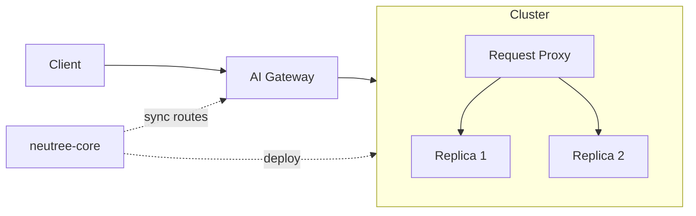

# Online Inference

This document describes how Neutree manages online inference services (Endpoints).

## Overview

Neutree provides OpenAI-compatible inference APIs with the following capabilities:

- **Multiple model types**: Text generation, embedding, reranker
- **Multiple inference engines**: vLLM, and other engines via plugin
- **High availability**: Multi-replica deployment with configurable placement
- **Load balancing**: KV cache-friendly routing strategies
- **Flexible GPU usage**: Tensor parallel (multi-GPU) and fractional GPU

## Architecture

Neutree handles two concerns for inference: **lifecycle management** and **request routing**.



- **AI Gateway**: Authenticates API keys and routes requests to the target cluster
- **Request Proxy**: Routes requests to replicas (Router in Kubernetes mode, Ray Serve Proxy in Static Nodes mode)
- **neutree-core**: Deploys endpoints and syncs routing config to AI Gateway
- **Images**: Kubernetes mode uses different images to run inference on different accelerators, and these are usually community-maintained images.

## Engine

An Engine defines an inference runtime (e.g., vLLM). Each engine can have multiple versions with different configurations.

- **Supported tasks**: Defines what model types the engine supports (text-generation, text-embedding)
- **Version schema**: Each version defines configurable parameters via JSON schema
- **Deploy template**: Kubernetes mode uses templates to generate Deployment manifests

### Engine Version Maintenance

For each Engine, the Neutree codebase maintains at most two versions: the
version included in the current generally available release and, when present,
the version included in the immediately preceding generally available minor
release.

Maintained Engine versions are automatically registered in every workspace. If
removed, they are restored automatically.

## Endpoint

An Endpoint is a deployed inference service. Key configurations:

- **Cluster**: Target cluster to deploy on
- **Engine**: Inference engine and version (e.g., vLLM v0.6.0)
- **Model**: Model source and name from a ModelRegistry
- **Resources**: CPU, memory, GPU per replica
- **Replicas**: Number of replica instances
- **Variables**: Engine-specific parameters (e.g., `gpu_memory_utilization` for vLLM), validated against engine's schema
- **Env**: Environment variables injected into the inference container

### Kubernetes Engine Arguments

The built-in Kubernetes templates render `spec.variables.engine_args` as CLI
arguments. They do not infer boolean actions from parameter names or maintain
engine-specific flag lists:

- A non-empty scalar value produces `--key value`. Booleans, including native
  `true` and `false`, are passed as the literal strings `true` and `false`.
- An empty string produces only `--key`, with no following value token. Omit
  the key entirely when the option should not be passed. An empty string is
  not a way to pass an empty value token to an option that requires a value.
- Every vLLM/SGLang option and value token is YAML-quoted by the template.
  Quotes, backslashes, and line breaks survive YAML decoding without becoming
  extra characters in the engine's argv. Structured values are serialized to
  JSON first, without pre-escaping them for YAML. llama.cpp's shell command
  quotes each engine option/value for the shell, then quotes the complete
  command for YAML so shell substitutions in values remain literal.
- Existing vLLM list expansion for native lists and raw JSON-array strings is
  unchanged; legacy pre-escaped JSON in string list items is also normalized.
  Historically pre-escaped JSON-array strings are normalized after list
  detection and remain a single JSON value token. SGLang still converts
  underscore option names to hyphenated CLI names; vLLM preserves the configured
  spelling.

For example, a vLLM Kubernetes endpoint can configure:

```yaml
spec:
  variables:
    engine_args:
      enforce_eager: ""
      no-enable-prefix-caching: ""
      max_model_len: 4096
      revision: "false"
```

This emits `--enforce_eager --max_model_len 4096
--no-enable-prefix-caching --revision false` as separate argv tokens.

Parameters implemented as `store_true`, `store_false`, or
`BooleanOptionalAction` do not accept a following `true` or `false` value.
Configure the actual positive or negative CLI option with `""` instead. To
leave a one-way flag unset, omit its key; do not configure `false`. Optional-value
options also preserve the supplied value: for example, `hf_token: true` emits
`--hf_token true`, whereas `hf_token: ""` emits the bare `--hf_token` option.
Check the selected engine version's CLI before choosing an option name.

Supply native objects or raw JSON strings without manually adding YAML
backslash escapes, for example, `config: '{"method":"mtp"}'`. Historical strings
whose actual contents are `{\"method\":\"mtp\"}` remain compatible: argument
preparation decodes exactly one JSON/YAML-compatible string-escape layer only
when the result is a valid JSON object or array. Native object serialization
is unchanged. Raw valid JSON, ordinary strings and backslashes, invalid
pseudo-JSON such as `{'111':'222'}`, and scalar strings remain unchanged.
This is not universal string unescaping
or single-quoted JSON repair. Normal JSON/YAML document encoding is still required.

Custom deploy templates registered under the built-in engine names must also
quote their raw argument values, rather than wrap pre-escaped values in manual
double quotes. This also applies to templates distributed in engine packages.
Other engine names retain the legacy argument-preparation behavior.

Existing Kubernetes configurations that relied on automatic boolean-to-flag
conversion must be migrated to this explicit form before their next deployment
reconciliation. The SGLang metrics default uses `enable_metrics: ""` on Kubernetes
so it remains a bare flag; the SSH/Ray default remains the native boolean `true`.
SSH/Ray applications receive Python argument values rather than these CLI tokens
and retain their existing typed-argument behavior.

#### Schema and UI Compatibility

For a CLI-only schema, represent flag-only inputs as strings so an explicit
empty string can mean a bare flag. If a parameter genuinely supports multiple
input types, JSON Schema can express them with, for example,
`"type": ["string", "boolean"]`; do not assume this changes how the CLI consumes
arguments. Under literal passthrough, even a native boolean becomes a value
token, not a bare flag.

The current UI only handles individual schema types. It has no union-type
selector and skips newly added empty values, so changing a schema alone does
not enable reliable creation of bare flags or selection between string and
boolean values. Configure explicit empty-string flags through Endpoint YAML/API
until the UI supports preserving empty strings and choosing a union type.

The built-in engine schemas are shared with SSH/Ray. This change does not
bulk-convert boolean fields to strings, because doing so would change the
Python-argument input contract. Schema and UI follow-up must distinguish CLI
inputs from native Python arguments and preserve the latter's types.

## Load Balancing

When an endpoint has multiple replicas, the routing strategy affects KV cache hit rates. Supported strategies:

- **Round Robin**: Distributes requests evenly across replicas in rotation.
- **Consistent Hashing with Bounded Loads**: Routes requests with similar prefixes to the same replica for better KV cache reuse. Falls back to next replica when load exceeds threshold.

### Consistent Hashing with Bounded Loads Algorithm

The CHWBL algorithm balances KV cache locality with load distribution:

**Hash Ring Construction**

Each replica is mapped to multiple positions on a hash ring using virtual nodes (default: 100 per replica). Virtual node positions are computed as `MD5(replica_id:index)`. More virtual nodes improve load distribution uniformity.

**Cache Key Extraction**

For OpenAI-compatible chat completions, the cache key is derived from:
- System prompt (if present)
- First N user messages (configurable, default: 2)

This ensures conversations with similar prefixes route to the same replica, maximizing KV cache reuse. For non-chat requests, the full payload is used as the cache key.

**Request Routing**

1. Hash the cache key and locate the nearest replica on the ring (binary search)
2. Check if the target replica meets the load constraint:
   - Calculate average load: `avg_load = (total_load + 1) / num_replicas`
   - Calculate threshold: `threshold = avg_load × load_factor` (default load_factor: 1.25)
   - Accept if `(replica_load + 1) ≤ threshold`
3. If rejected, check the next replica on the ring
4. If all replicas exceed the threshold, fall back to the initially selected replica

**Configuration Parameters**

| Parameter | Default | Description |
|-----------|---------|-------------|
| `virtual_nodes_per_replica` | 100 | Number of virtual nodes per replica on the hash ring |
| `load_factor` | 1.25 | Maximum load relative to average (1.25 = 25% above average) |
| `max_user_messages_for_cache` | 2 | Number of user messages included in cache key |

## GPU Allocation

Neutree uses `CUDA_VISIBLE_DEVICES` to control GPU access. Important notes:

- **No hard isolation**: Current version does not enforce GPU memory isolation at hardware level
- **Fractional GPU**: Multiple workloads sharing one GPU will all see the full device. Memory control relies on engine configuration (e.g., vLLM's `--gpu-memory-utilization`)
- **Tensor Parallel**: Workloads see multiple GPUs via `CUDA_VISIBLE_DEVICES`. Engine must correctly utilize all visible devices.
